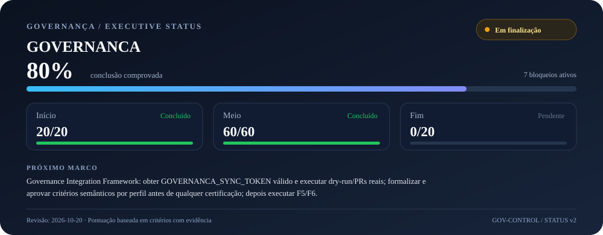

# GOVERNANCA — Sistema Mestre de Governança e Orquestração

| Campo | Valor |
|---|---|
| **ID** | GOV-README-001 |
| **Projeto** | GOVERNANÇA |
| **Repositório** | [carlos-andrade/GOVERNANCA](https://github.com/carlos-andrade/GOVERNANCA) |
| **Tipo documental** | README |
| **Fase** | Entrada e orientação do repositório |
| **Estado** | EM_REVISAO |
| **Versão** | 1.1.0 |
| **SHA-256 (conteúdo canónico)** | 24497dbaa0763db6849a234fa03527ef071233445016dac7949224a9ad4f23e1 |
| **Commit de referência (versão anterior)** | [62a2354c6372417a36c4df256fff267e691d8495](https://github.com/carlos-andrade/GOVERNANCA/commit/62a2354c6372417a36c4df256fff267e691d8495) |
| **Data de criação** | N/A — data histórica de criação não verificada |
| **Data de atualização** | 2026-10-17 |
| **Responsável** | Proprietário do repositório GOVERNANCA |
| **Aprovador** | Pendente de aprovação formal do README |
| **Autoridade superior** | [CONSTITUICAO.md](CONSTITUICAO.md) e [Norma de cabeçalho](CABE%C3%87ALHO/NORMA-CABECALHO-PADRAO.md) |
| **Cadeia de autoridade** | PROMPTS → CARTAS → LAYOUT ÚNICO → CÓDIGO |

> Repositório-mestre para definir como projetos são propostos, priorizados, desenhados, executados, controlados, auditados e encerrados.

**Estado:** V1, proposta inicial em revisão. A existência de documentos não significa que políticas foram formalmente ratificadas ou que controlos técnicos estejam ativos.

<!-- GOVERNANCA_STATUS_START -->
## Painel executivo de status — GOVERNANCA

**80% comprovados** · `[████████████████░░░░] 80%` · **Estado:** Em finalização · **Fase:** Fim

| Fase | Pontos comprovados | Peso máximo | Estado |
|---|---:|---:|---|
| **Início** | 20/20 | 20% | Concluído |
| **Meio** | 60/60 | 60% | Concluído |
| **Fim** | 0/20 | 20% | Pendente |

**Próximo marco:** Executar F1 — Especificação do Governance Integration Framework; em paralelo, resolver GOVERNANCA_SYNC_TOKEN e validar dry-run/PRs reais da distribuição transversal.

**Bloqueios ativos (7):**
- A correção transversal de publicação concorrente dos 42 workflows ainda precisa de verificação conclusiva na branch main; não retirar o bloqueio sem evidência atual.
- Os limiares de atualidade BCB SGS, BDI, COTAHIST anual (30 dias) e COTAHIST diário (5 dias) continuam PROVISIONAL, sem aprovação dos proprietários registada.
- A supervisão externa independente ainda não foi comprovada como operacional: faltam confirmar configuração dos secrets, ausência de heartbeat e recuperação.
- Responsáveis, canais de alerta, confirmação de receção, ACK/escalonamento e SLA ainda precisam de aprovação e teste com evidência.
- A adoção transversal do padrão de roadmap e das regras de governança continua sujeita a inspeção, integração e aceitação individual por repositório.
- A distribuição automática por Pull Request foi implementada inicialmente, mas a operação ainda não está comprovada: falta validar o secret GOVERNANCA_SYNC_TOKEN, executar dry-run e confirmar PRs/idempotência em todos os destinos.
- Governance Integration Framework: arquitetura DEC-GOV-INT-001 integrada em main; implementação F1–F6 ainda pendente e não declarar operacional antes dos critérios de aceitação.

**Última revisão:** 2026-10-20 · **Atualização do registo:** 2026-10-20

> **Limite da revisão:** Revisão documental em 2026-10-17. O workflow de sincronização executou com sucesso os testes automatizados, gerou o README e o SVG e confirmou a sincronização final nos runs 38981823399 e 38981877103. Os 10 pontos de testes da barra v2 foram atribuídos com evidência de CI. A aceitação externa do WATCHDOG continua pendente: a issue B3 #9 está fechada no GitHub, mas a checklist publicada não tem evidência de conclusão; fechar a issue isoladamente não prova aceitação operacional. A adoção transversal ainda exige validação individual por repositório. Implementação inicial da distribuição transversal publicada em 2026-10-17 (script, workflow, registo de consumidores e testes de validação); não considerar operacional até autenticação, dry-run e PRs reais serem verificados. Verificação técnica adicional em 2026-10-17: no workflow [run 38995449792](https://github.com/carlos-andrade/GOVERNANCA/actions/runs/38995449792), o job `validar` passou e o job `propagar` falhou na autenticação porque o secret `GOVERNANCA_SYNC_TOKEN` contém um token inválido. Não houve tentativa de distribuição nem Pull Requests criadas nessa execução. O workflow foi ajustado para guardar um relatório de diagnóstico também quando a autenticação falha; essa correção ainda aguarda execução CI posterior. Formalização da arquitetura em 2026-10-20: a decisão DEC-GOV-INT-001 foi integrada em main pela PR #3, commit 7003bd9848983c211aca588e68e5281a5babc39a. O documento define arquitetura, controlos, roadmap F1–F6 e critérios de aceitação; a implementação integral permanece pendente. A integração não altera o estado operacional da distribuição transversal, que continua bloqueada até validação do GOVERNANCA_SYNC_TOKEN, dry-run autenticado e PRs reais.

**Evidências:** [DEC-GOV-INT-001 — Governance Integration Framework (merged)](https://github.com/carlos-andrade/GOVERNANCA/blob/main/docs/01-governanca/DEC-GOV-INTEGRATION-FRAMEWORK-001.md) · [Validação CI do scorecard e painel visual a 80% — SUCCESS](https://github.com/carlos-andrade/GOVERNANCA/actions/runs/38981877103) · [Norma de percentual e estados](https://github.com/carlos-andrade/GOVERNANCA/blob/main/standards/status-e-percentual-de-conclusao.md) · [Testes automatizados da barra](https://github.com/carlos-andrade/GOVERNANCA/blob/main/tests/test_sync_project_status.py) · [Workflow de sincronização](https://github.com/carlos-andrade/GOVERNANCA/blob/main/.github/workflows/sync-project-status.yml) · [WATCHDOG — validação técnica](https://github.com/carlos-andrade/GOVERNANCA/actions/workflows/watchdog-validation.yml) · [Gate de aceitação WATCHDOG/B3](https://github.com/carlos-andrade/B3/issues/9) · [Issue de atualidade de dados B3](https://github.com/carlos-andrade/B3/issues/8)

> **Fonte de verdade:** `registry/status-do-projeto.json`. O script valida os critérios pontuados e gera este painel Markdown e o SVG. Não editar manualmente este bloco. Uma fase só recebe pontos se tiver evidência; 100% exige aprovação explícita de todos os controlos de encerramento.
<!-- GOVERNANCA_STATUS_END -->

## Distribuição transversal das regras

A distribuição das regras canónicas é orquestrada por [`propagar-regras-governanca.yml`](.github/workflows/propagar-regras-governanca.yml), com registo explícito em [`registry/repositorios-consumidores.json`](registry/repositorios-consumidores.json), script [`automation/propagar_governanca.py`](automation/propagar_governanca.py) e procedimento [`docs/01-governanca/distribuicao-automatica-regras.md`](docs/01-governanca/distribuicao-automatica-regras.md). As atualizações são propostas por Pull Request para revisão local; não existe merge automático. A execução operacional depende do secret `GOVERNANCA_SYNC_TOKEN` e da validação bem-sucedida do workflow.

## Governance Integration Framework

A arquitetura foi formalmente aprovada e integrada através da decisão [DEC-GOV-INT-001 — Governance Integration Framework](docs/01-governanca/DEC-GOV-INTEGRATION-FRAMEWORK-001.md), commit [`7003bd9`](https://github.com/carlos-andrade/GOVERNANCA/commit/7003bd9848983c211aca588e68e5281a5babc39a). O roadmap aprovado contém seis fases (F1–F6), critérios de aceitação, controlo por Pull Request, preservação dos ficheiros locais, auditoria e validação individual por repositório.

**Estado:** arquitetura integrada; implementação do framework ainda pendente. A distribuição transversal existente continua sem validação operacional enquanto não forem confirmados `GOVERNANCA_SYNC_TOKEN`, dry-run autenticado e Pull Requests reais nos destinos.

## Começar por aqui

**Monitorização transversal obrigatória:** consulte o [WATCHDOG](WATCHDOG/README.md), o [registo de sistemas monitorizados](WATCHDOG/registry/sistemas-monitorizados.json) e o [workflow de validação](.github/workflows/watchdog-validation.yml). O MVP valida configurações e ficheiros locais; integrações externas e monitorização contínua ainda exigem implementação e testes próprios.

1. Leia [`CONSTITUICAO.md`](CONSTITUICAO.md) e [`docs/00-fundamentos/modelo-operacional.md`](docs/00-fundamentos/modelo-operacional.md).
2. Registe a iniciativa a partir de [`templates/projeto/charter.md`](templates/projeto/charter.md).
3. Classifique risco com [`templates/avaliacao/triagem-risco.md`](templates/avaliacao/triagem-risco.md).
4. Defina resultados mensuráveis, owner, dependências, riscos e critérios de aceitação.
5. Siga os gates G0–G6 descritos em [`docs/02-ciclo-de-vida/ciclo-de-vida-e-gates.md`](docs/02-ciclo-de-vida/ciclo-de-vida-e-gates.md).
6. Registe decisões, alterações, testes, incidentes e evidências.
7. Antes de produção, utilize [`templates/release/checklist-prontidao.md`](templates/release/checklist-prontidao.md).
8. Desde o início, publique no README do projeto a barra e o percentual usando [`templates/projeto/status-do-projeto.md`](templates/projeto/status-do-projeto.md), conforme a norma [`standards/status-e-percentual-de-conclusao.md`](standards/status-e-percentual-de-conclusao.md).

## Estrutura documental

- `CONSTITUICAO.md` — princípios e autoridade, incluindo a norma transversal WATCHDOG.
- `WATCHDOG/` — política, arquitetura, contratos, inventário, motor de validação, adaptadores, runbooks e testes de monitorização.
- `docs/00-fundamentos/` — modelo operacional, taxonomia e adaptação proporcional.
- `docs/01-governanca/` — papéis, decisões, exceções e estados documentais.
- `docs/02-ciclo-de-vida/` — gates, requisitos e escopo.
- `docs/03-portfolio-e-estrategia/` — priorização.
- `docs/04-arquitetura-e-engenharia/` — padrões e controlo de versão.
- `docs/05-dados-e-ia/` — governança de dados, qualidade, linhagem e IA.
- `docs/06-seguranca-e-privacidade/` — segurança, privacidade e risco.
- `docs/07-operacoes-e-resiliencia/` — observabilidade, continuidade e incidentes.
- `docs/08-qualidade-e-validacao/` — critérios e validação.
- `docs/09-entrega-e-mudanca/` — mudanças e releases.
- `docs/10-fornecedores-e-dependencias/` — terceiros e licenças.
- `docs/11-financas-e-beneficios/` — custos e benefícios.
- `docs/12-conhecimento-e-documentacao/` — conhecimento institucional.
- `docs/13-comunicacao-e-stakeholders/` — comunicação e escalonamento.
- `docs/14-metricas-e-melhoria/` — indicadores e revisão.
- `docs/15-dominios-especializados/` — perfis por tipo de projeto.
- `templates/` — modelos reutilizáveis e checklists, incluindo o estado percentual de conclusão de cada projeto.
- `standards/status-e-percentual-de-conclusao.md` — cálculo uniforme, critérios de evidência e estados de conclusão.
- `standards/` — convenções.
- `registry/` — índices centrais leves.
- `automation/` — especificações para controlos automatizáveis.
- `.github/workflows/watchdog-validation.yml` — validação automatizada do motor WATCHDOG e dos registos locais.
- `examples/` — exemplos não normativos.

## Regras fundamentais

- Todo projeto tem objetivo, responsável, beneficiários e critérios verificáveis.
- O controlo é proporcional ao risco e não dispensa obrigações legais/contratuais.
- Nenhum segredo ou dado pessoal desnecessário deve entrar em Git.
- Nenhum teste, execução ou publicação é declarado sem evidência verificável.
- Exceções têm dono, justificação, aprovador, prazo e plano de resolução.
- O repositório mestre guarda padrões; os repositórios de projeto guardam implementação e evidências específicas.

## Limitações da V1

Não é uma certificação, parecer jurídico, implementação automática de conformidade ou proteção de branch. Os workflows existentes validam os respetivos artefactos quando acionados, mas não substituem monitorização independente 24×7. O WATCHDOG está em fase MVP: verificações locais e testes automatizados estão definidos; adaptadores externos, alertas operacionais, persistência protegida de evidências e supervisão independente ainda precisam de ser implementados e testados. O documento de apoio fornecido sobre modelos de governança de dados é referenciado na política em `docs/05-dados-e-ia/governanca-de-dados.md`.

## Padrão obrigatório de roadmap

O roadmap deste repositório e dos projetos que adotem formalmente estas regras deve seguir o [Roadmap padrão — Governança](ROADMAP-PADRAO-GOVERNANCA.md), nos termos da [Carta/Contrato — padrão obrigatório de roadmap](CARTA-CONTRATO-PADRAO-ROADMAP.md). A existência da norma não certifica automaticamente os repositórios adotantes: cada repositório deve ser inspecionado e validado individualmente.
